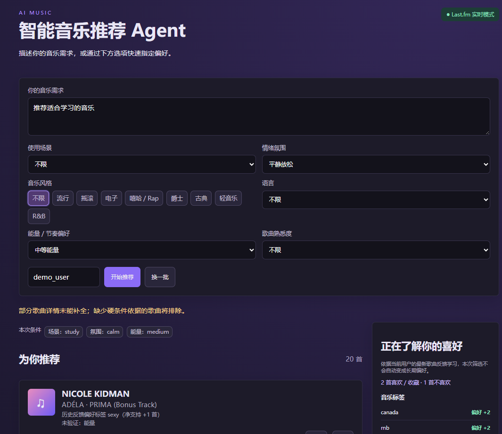
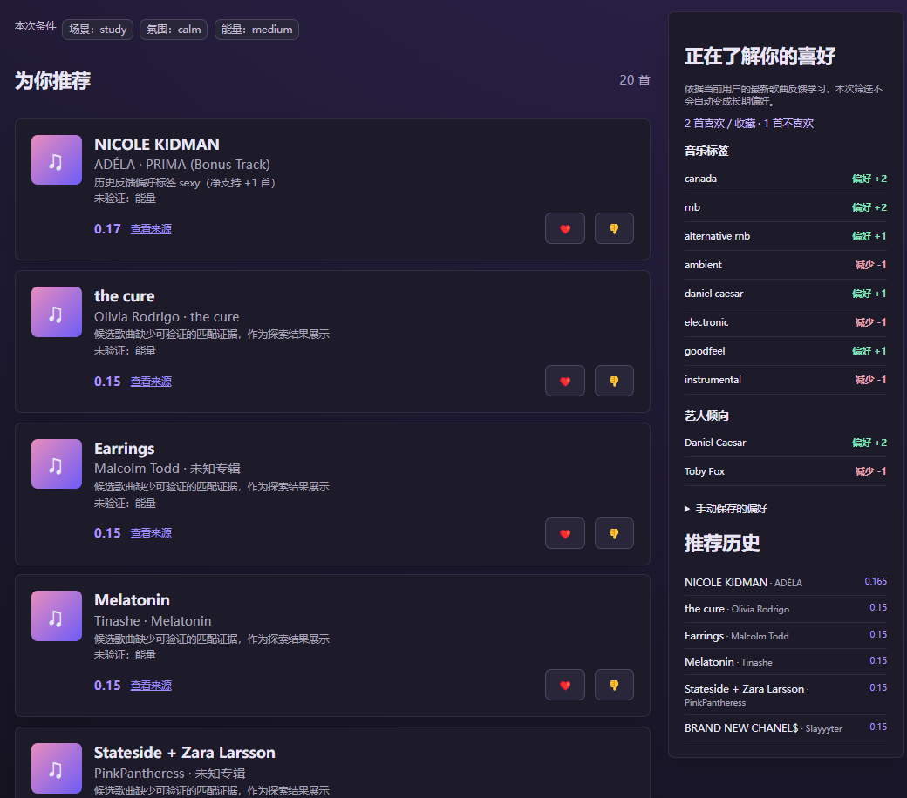

# 智能音乐推荐 Agent

一个可运行的 FastAPI + Vue 3 音乐推荐 Agent：用户用自然语言和筛选条件描述需求，后端调用音乐数据源，完成候选检索、过滤、排序、去重，并记录历史与反馈。

## 项目展示图片
<p align="center">
  
  &nbsp;&nbsp;
  
</p>

## 功能

- Mock 模式开箱即用，无 API Key 也能推荐
- Last.fm 搜索/相似歌曲接口（关闭 Mock 后启用）
- MusicBrainz 客户端扩展位
- 偏好、历史、like/dislike/skip/save 反馈
- 场景、氛围、风格多选、语言、能量、歌曲熟悉度六项临时筛选
- 可选 OpenAI 兼容 LLM 检索规划、工具选择和最多三轮检索迭代；失败时使用规则回退
- 每请求结构化日志、硬条件检查、候选质量指标及离线评估脚本
- 可解释的程序化评分与艺术家/流派多样性
- Swagger `/docs` 与 ReDoc `/redoc`

## 技术架构

Vue 3 + Vite → FastAPI → LLM 制定检索计划 → 白名单工具检索 → 补充标签、硬条件过滤和排序 → LLM 根据结果决定下一轮或结束 → SQLite/SQLAlchemy。歌曲、标签、链接与推荐理由的证据来自数据源。每轮观测和最终评估记录到 JSONL 日志。完整模块职责、预算、响应字段和评估口径见 [后端说明](backend/README.md)。

## 快速启动本项目

要求 Python 3.11+、Node.js 20+。

可直接在 PyCharm 底部的 PowerShell 终端执行。以下命令从项目根目录开始；如果已进入 `backend`，无需再次执行 `cd backend`。已有虚拟环境时可跳过创建步骤。

```powershell
cd backend
.\.venv\Scripts\python.exe -m uvicorn app.main:app --reload --host 127.0.0.1 --port 8001
```

在 `frontend/.env.local` 中设置 `VITE_API_BASE_URL=http://127.0.0.1:8001/api`，确保前端连接同一端口。然后从项目根目录另开终端：

```powershell
cd frontend
npm run dev -- --configLoader runner
```

访问 http://localhost:5173，API 文档 http://127.0.0.1:8001/docs。

本地开发统一使用后端端口 8001。若修改端口，必须同时修改后端的 `--port` 参数和 `frontend/.env.local` 中的地址。修改前端环境配置后，重启 Vite 并刷新浏览器。保持前后端两个终端运行；后端带 `--reload`，保存 Python 代码后会自动重新加载。


## 配置

`.env.example` 包含 `LLM_API_KEY`、`LLM_BASE_URL`、`LLM_MODEL`、`LLM_MOCK_MODE`、`LASTFM_API_KEY`、`DATABASE_URL`、`MOCK_MODE`。
默认 `MOCK_MODE=true`；切换为 false 要填写 Last.fm API Key 后使用真实搜索。
要启用 LLM，填写前三项并保持 `LLM_MOCK_MODE=false`。
模型的 Base URL 必须是 OpenAI 兼容接口的根地址，后端会请求其 `/chat/completions`。

后端固定读取 `backend/.env`，不依赖启动目录；系统环境变量优先于该文件。修改后需要重启后端。实时模式缺少 Last.fm Key 会返回配置错误，不会自动使用 Mock 数据。
`

## 推荐算法

反馈学习 → LLM 规划（软偏好、硬条件、初始工具调用）→ 执行、去重、补充标签 → 硬过滤与排序 → 候选不足时由 LLM 调整工具和查询 → 返回实际结果并记录评估与历史。

- 每首歌只按最新反馈计算：like/save 为 +1，dislike 为 -1，skip 不推断口味。重复点赞不会增加支持票，改回喜欢会撤销先前不喜欢的影响。
- 从已保存歌曲的标签和艺人计算长期倾向，不从请求文字、歌曲名称猜测属性。每项信号保留正负反馈计数和最多 5 首来源歌曲；缺标签时仅使用已有艺人信息。
- 学习结果保存在原 user_preferences 表的 learned_profile_json 列，手动设置字段保持独立。旧反馈在首次读取偏好或推荐时自动参与重建。
- 向规划器提供最多 3 首喜欢/收藏歌曲作为相似检索种子；模型只能引用这些种子 ID。Mock 模式用本地标签交集模拟相似检索。
- 排序优先比较本次条件的可验证匹配维度，再使用有上限的长期倾向、反馈、相似来源和重复惩罚调整。单首负反馈排除该歌曲，对其标签和艺人只软降权。
- LLM 可选：配置后会收到手动偏好、带证据的学习摘要、目标数量和调用预算。初始规划后，模型可以根据各轮合格候选数、过滤原因和工具结果决定继续搜索或停止。无 LLM 时，Python 仍完成规则检索、反馈学习和个性化排序。
- 明确语言、排除项和必须标签在迭代中保持不变。条件冲突或模型发现无法核验的硬要求时返回澄清问题；用户修改条件后重新提交。
- 候选不足时返回实际数量并提示，不伪造歌曲。

### 如何体验反馈学习

1. 启动前后端，固定一个用户 ID，点击“开始推荐”。
2. 对几首歌点击喜欢或不喜欢，右侧“正在了解你的喜好”立即显示音乐标签和艺人倾向。
3. 展开任一标签，查看支持它的歌曲、正负反馈次数；Mock 证据会明确标注。
4. 再次推荐，歌曲理由中会出现“历史反馈偏好标签”或“相似推荐来源”。这是新歌从历史口味获得推荐权重的依据。
5. 选择与历史风格不同的明确条件，本次匹配优先。点击“换一批”沿用上次成功请求的条件。
6. 刷新后保持同一用户 ID，偏好和反馈会重新加载；再次出现的歌曲恢复反馈按钮状态。切换用户时会清空前一个用户的展示。

接口新增 GET /api/feedback/{user_id}，返回每首歌最新反馈。GET /api/preferences/{user_id} 在保留原字段的同时增加 learned。推荐卡片响应增加 feedback_type。


## 数据库

`users`、`user_preferences`、`tracks`、`recommendation_history`、`feedback` 五张表；可结构化字段保持独立，标签与外部元数据作为补充字段。

## 测试与扩展

在 `backend` 目录执行 `.\.venv\Scripts\python.exe -m pytest tests -q`；执行 `.\.venv\Scripts\python.exe scripts/evaluate_agent.py --output logs/evaluation-offline.json` 生成离线流程评估。首次运行升级后的后端时，兼容添加历史字段和 user_preferences.learned_profile_json；迁移前生成 music_agent.db.pre-feedback-learning.bak，不清空已有记录。

## 当前限制

- Last.fm 社区标签可能误标，卡片明确提示尚未核验歌词语言。
- Mock 数据集只有 12 首歌曲，因此 Mock 模式下无法实际返回 20 首；真实 Last.fm 模式会尽量补足，候选仍不足时会显示提示。
- 学习的是数据源提供的标签和艺人倾向，不代表已验证歌曲语言、情绪或 BPM。没有标签就不会推断标签；暂未实现时间衰减、协同过滤和账号登录。用户隔离依赖 user_id。


